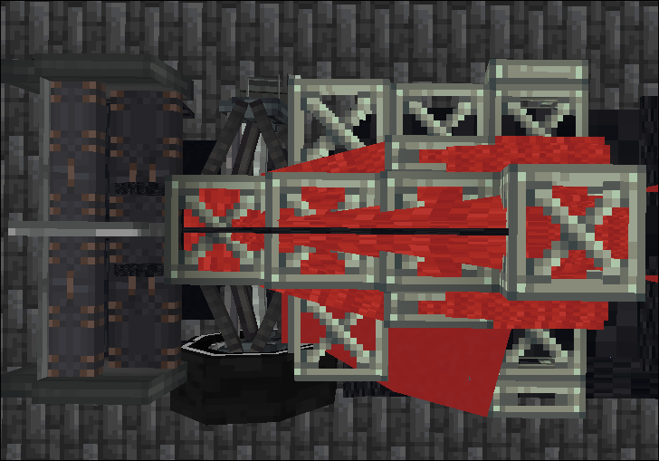
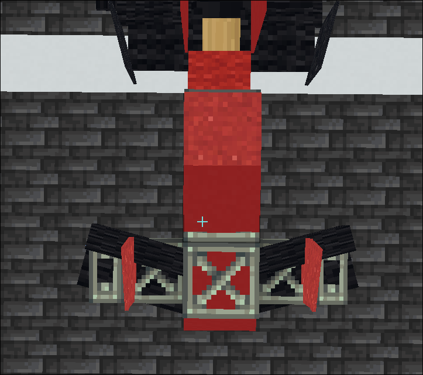
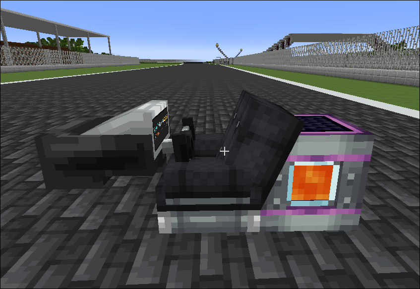
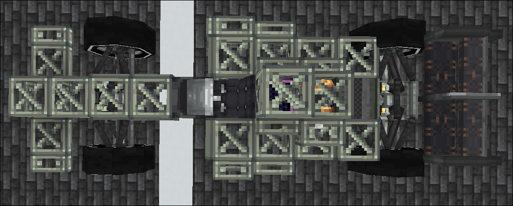

# Create MotorSports FIA: Technical Regulations

**Set 1, Version 5**

---

## 1. Dimensions and Weight

- **1.1. Length:** 10 to 12 blocks.
- **1.2. Width:** Maximum 3.5 blocks at all times and under all circumstances (bodywork only, wheels excluded). This limit is absolute and cannot be exceeded under any tolerance in this regulation.
- **1.3. Weight:** Minimum 36 kg, maximum 72 kg.
- **1.4. Width tolerance in zones:** In the zones defined in Section 3, a width deviation of ±0.5 blocks is permitted only where the deviation is non-functional and serves purely visual purposes. This tolerance never allows the total width specified in 1.2 to be exceeded.

---

## 2. Aerodynamics

- **2.1.** Only "Down Flaps" from Create: Motorsport are allowed at the rear. Their DRS mode is permitted; it is an intended function of the part and is not a geometry or aerodynamics modification under 2.5 and 6.6.
- **2.2.** A maximum of 4 aerodynamic elements, excluding "Down Flaps" from Create: Motorsport, are allowed.
- **2.3.** No aerodynamic element may be placed higher than 2 blocks above ground clearance.
- **2.4.** Aerodynamic elements from Create: Aeronautics are strictly limited to a maximum height of 1 block above ground clearance.
- **2.5.** Any mechanism, device or modification that changes the car's length, width, height, wheelbase or aerodynamic profile during operation or while stationary is prohibited. This includes pistons, extensions, retractable parts and similar systems, except where the component is a part of Create: Motorsport as specified in this regulation, and except the DRS mode of "Down Flaps" described in 2.1.

---

## 3. Zoning

- **3.1. Monocoque zone:** 3 x 1 x 1 blocks (Width x Length x Height). *(see Figure 3)*
- **3.2. Front zone:** From the front axle to the start of the front wing, exactly 2 blocks. *(see Figure 4)*
- **3.3.** From the end of the monocoque to the front wing, minimum 5 blocks (including wheelbase, excluding the front wing itself).
- **3.4. Rear zone:** From the rear of the monocoque to the rear wing, minimum 1 block. *(see Figure 4)*
- **3.5.** From the rear wing to the rear axle, minimum 1 block. *(see Figure 4)*
- **3.6. Front wheel zone:** In the area 1 block forward and 1 block backward from the front axle, bodywork width must be exactly 1 block.

---

## 4. Height and Visibility

- **4.1. Overall height:** Maximum 2.5 blocks.
- **4.2. Driver visibility:** Looking forward from the driver seat, no structure may exceed 1.25 blocks above ground clearance.

---

## 5. Safety and Construction

- **5.1. Cockpit protection:** The cockpit must be protected by non-transparent blocks on the sides and rear. The front may remain open.
- **5.2. Wheel clipping:** A slight clipping of the wheel into the bodywork is permitted, up to 0.15–0.2 blocks of the wheel radius.
- **5.3.** Wheels must rotate and steer freely without clipping through any blocks or textures of the car beyond the limit set in 5.2.
- **5.4.** The car must not scrape against the track surface at speeds below 150 km/h in-game.
- **5.5.** The car must be objectively safe. For example, it is objectively unsafe if the driver is positioned upside down.
- **5.6.** When using "Workspace" to model the car, the part must be covered by a copycat layer to have a hitbox, and its hitbox must be a good approximation of the QModelling shape. *(see Figures 1 and 2)*

---

## 6. Powertrain and Movement

- **6.1.** All acceleration and braking must come solely from the engine and wheels from Create: Motorsport.
- **6.2.** Strictly prohibited: any propellers, jet burners, air-reactive engines, active stabilizers (gyroscopes), or any other external source of thrust or momentum (even if not actively used).
- **6.3.** Exactly 4 wheels: 2 front (F1 Slick Front), 2 rear (F1 Slick Rear).
- **6.4.** The car must be Rear Wheel Drive. Only the front wheels may steer, and only via the Steering system. Any other method of turning the car is prohibited.
- **6.5.** Active suspension is completely forbidden.
- **6.6.** Any part, mechanism or modification not provided by Create: Motorsport that alters the car's geometry (length, width, height, wheelbase, track) or aerodynamics, whether permanently or during operation, is prohibited. This includes, but is not limited to, pistons, telescopic or sliding parts, hydraulic or pneumatic actuators, and any components from other mods used for the same purpose. The DRS mode of Create: Motorsport "Down Flaps" is not covered by this prohibition (see 2.1).

---

## 7. On-Track Behavior

- **7.1.** The car must remain stable on all 4 wheels at all times (excluding jumping over bumps or trampolines).
- **7.2.** The car must consist strictly of one Sublevel.

---

## 8. Terms and Definitions

- **Ground clearance:** A reference plane: the lowest point of the bodywork, i.e. the lowest face of any block that is part of the bodywork.
- **Monocoque:** A 3 x 1 x 1 block cluster that includes blocks in this order: Steering Wheel → Seat (any seat from Create and/or Create: Interior) → Fuel tank of any kind.
- **Bodywork:** Anything outside of the Monocoque, excluding suspension and wheels.
- **Active suspension (6.5):** Passive suspension is required.
- **Scrape (5.4):** Any contact with the ground that is not made by the wheels counts.
- **Geometry and aerodynamics modification (2.5, 6.6):** Any change in the car's dimensions, wheelbase, track, ride height or aerodynamic profile that is achieved by moving, extending or retracting components, or by using parts outside Create: Motorsport, regardless of whether the change is active or passive. The DRS mode of Create: Motorsport "Down Flaps" is excluded from this definition.

---

## 9. Images

**Figure 1 and 2: Workspace hitbox (5.6)**

**Figure 3: Monocoque zone (3.1)**

**Figure 4: Front, rear and axle zones (3.2, 3.4, 3.5)**

---

*by @ᴍᴀɴɪꜱᴋ and @notweb*
